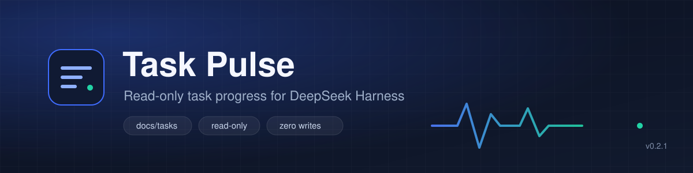

# Task Pulse



[](https://github.com/SwingRainbow/dsh-task-pulse/actions/workflows/ci.yml)
[](LICENSE)
[](https://github.com/deepseek-ai/deepseek-harness)
[](package.json)

**Task Pulse** is a read-only [DeepSeek Harness](https://github.com/deepseek-ai/deepseek-harness) (`dsh`) plugin. It adds a **Progress (进度)** view beside the conversation and projects the current workspace's `docs/tasks/` Markdown into a status page you can scan in a few seconds.

English | [中文](README.zh.md)

## Why Task Pulse

Task records are written for agents: long Markdown with every field. Task Pulse keeps those records as the source of truth and shows only what a person needs to decide what to do next. It never writes files, calls the network, or runs shell commands.

## Features

| | |
|---|---|
| **Grouped progress** | Now / Waiting for you / Next / Paused / Needs verification. Empty groups are hidden. |
| **Task rows** | Name, phase, date, next step, blockers. Click for the full record. |
| **Detail card** | Goal, scope, latest progress, evidence links, copy actions. |
| **Decisions** | Filterable decision log with evidence links. |
| **Activity** | Recent progress entries and the latest handoff. |
| **Health** | File sizes, stale tasks, parser warnings. |
| **Onboarding** | Copy a complete prompt that teaches an agent the record format. |
| **Read-only** | No writes, no network, no shell. |

## Install

Requires DSH `0.2.3-alpha.2`. For development, Node.js 20 or newer.

From the DSH plugin UI: **Plugins → Add plugin → Git address**, then enter:

```text
https://github.com/SwingRainbow/dsh-task-pulse
```

Or from a terminal:

```sh
dsh plugin --profile web add github:SwingRainbow/dsh-task-pulse
```

Use `--profile desktop` for the desktop profile. Restart or refresh DSH after installing. The **Progress** tab appears in non-blank sessions.

Local development:

```sh
dsh plugin --profile desktop add link:/absolute/path/to/dsh-task-pulse
```

Published builds include `lib/client.js`; Git installs do not need a build step.

## What it reads

| File | Used for |
|---|---|
| `docs/tasks/BOARD.md` | Current tasks, phases, next steps, blockers, evidence |
| `docs/tasks/DECISIONS.md` | Decision log |
| `docs/tasks/progress.md` | Activity feed and the latest handoff |
| `docs/tasks/task_plan.md`, `findings.md`, `ARCHIVE_INDEX.md` | Size and health only |

Paths are relative to the session workspace. The view reloads when a file version changes, checked every 5 seconds.

## New project? Copy the prompt

If the workspace has no `docs/tasks/` records, the tab shows an onboarding card instead of an error. **Copy prompt** copies [`prompts/task-records.md`](prompts/task-records.md), a self-contained specification that tells an agent how to read the project and create `BOARD.md`, `DECISIONS.md`, and `progress.md` in the expected format.

The plugin stays read-only; the agent creates the files after you paste the prompt.

## How it works

- Registers a `conversation.view` slot and renders a React page inside DSH.
- Reads files through `ctx.remote.workspaceFiles` (`readBytes` / `stat`).
- Parses Markdown with `src/parse.mjs`; no network, no shell, no writes.
- Polls file versions every 5 seconds and reloads when they change.
- Bundles the parser and prompt into `lib/client.js` at build time.

## Compatibility

| | |
|---|---|
| DSH | `^0.2.3-alpha.2` |
| Node.js | `>=20` (build and tests) |
| Client | Web (`dsh.client.platform = "web"`) |
| Data | Read-only `docs/tasks/` Markdown |

The DSH client module format is validated against the installed runtime. Re-check it after a DSH upgrade.

## Development

```sh
npm run build   # rebuild lib/client.js
npm test        # parser, build consistency, prompt examples
```

Tests use fixed fixtures in `test/fixtures/`. Edit `src/client.template.js`, `src/parse.mjs`, or `prompts/task-records.md`, then rebuild.

## Project layout

```text
.
├── src/                  parser and client template
├── lib/                  built client bundle (committed for Git installs)
├── prompts/              onboarding prompt, inlined at build time
├── locale/               plugin manager metadata
├── test/                 fixtures and Node tests
├── cordis.patch.yml      DSH bundle patch
└── package.json          DSH manifest
```

## Non-goals

- No editing, drag-and-drop phase changes, or write-back.
- No workspace-wide aggregation; the tab follows the current session workspace.
- No archive browser in 0.2.0. Existing archive links still open in the evidence drawer.

## License

MIT — see [LICENSE](LICENSE).
