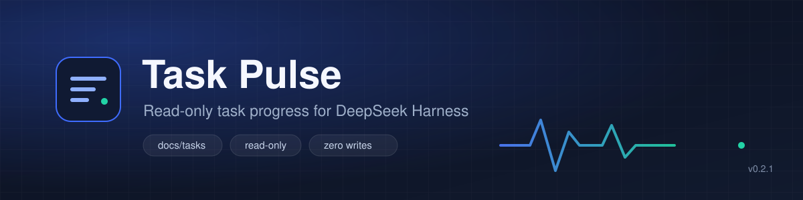

# Task Pulse



[](https://github.com/SwingRainbow/dsh-task-pulse/actions/workflows/ci.yml)
[](LICENSE)
[](https://github.com/deepseek-ai/deepseek-harness)
[](package.json)

**Task Pulse** 是一个只读的 [DeepSeek Harness](https://github.com/deepseek-ai/deepseek-harness)（`dsh`）插件。它在会话旁增加一个「进度」页签，把当前工作区 `docs/tasks/` 下的 Markdown 任务记录，投影成一页几秒就能看完的状态。

[English](README.md) | 中文

## 为什么叫 Task Pulse

任务记录是写给 Agent 看的：字段多、文件长。Task Pulse 让记录继续做唯一事实源，只把“现在在做什么、什么在等用户确认、什么暂停了”提炼出来。插件不写文件、不联网、不执行 shell。

## 功能

| | |
|---|---|
| **分组进度** | 现在在做 / 等你确认 / 接下来 / 暂缓 / 待核实；没有任务的分组自动隐藏。 |
| **任务行** | 任务名、阶段、日期、下一步、等待项；点击查看完整记录。 |
| **详情卡** | 目标、范围、最近完成点、证据链接和复制按钮。 |
| **决定** | 可筛选的决定记录，保留证据链接。 |
| **动态** | 最近的进度段和最新会话交接。 |
| **健康** | 文件体积、过期任务、解析提示。 |
| **接入提示** | 没有记录结构的工作区可复制一份完整提示词给 Agent。 |
| **只读** | 不写文件、不联网、不执行 shell。 |

## 安装

需要 DSH `0.2.3-alpha.2`；开发构建使用 Node.js 20 以上。

DSH 插件页：**插件 → 添加插件 → Git 地址**，填入：

```text
https://github.com/SwingRainbow/dsh-task-pulse
```

或在终端：

```sh
dsh plugin --profile web add github:SwingRainbow/dsh-task-pulse
```

桌面端把 `--profile web` 换成 `--profile desktop`。安装后重启或刷新 DSH；「进度」页签会出现在非空白会话里。

本地开发：

```sh
dsh plugin --profile desktop add link:/absolute/path/to/dsh-task-pulse
```

仓库里已提交 `lib/client.js`，Git 安装不需要再构建。

## 读取什么

| 文件 | 用途 |
|---|---|
| `docs/tasks/BOARD.md` | 当前任务、阶段、下一步、阻塞项、证据 |
| `docs/tasks/DECISIONS.md` | 决定记录 |
| `docs/tasks/progress.md` | 动态和最新会话交接 |
| `docs/tasks/task_plan.md`、`findings.md`、`ARCHIVE_INDEX.md` | 只做体积和健康提示 |

路径相对当前会话工作区。文件版本变化后自动重载，每 5 秒检查一次。

## 新项目？复制提示词

工作区没有 `docs/tasks/` 记录时，页签显示接入卡而不是报错。「复制提示词」复制的是 [`prompts/task-records.md`](prompts/task-records.md)，一份自包含的规范：Agent 读完当前项目后，按固定格式建立 `BOARD.md`、`DECISIONS.md` 和 `progress.md`。

插件仍然只读，文件由 Agent 在你确认后创建。

## 工作原理

- 注册 `conversation.view` 槽位，在 DSH 里渲染 React 页面。
- 通过 `ctx.remote.workspaceFiles` 的 `readBytes` / `stat` 读取文件。
- 用 `src/parse.mjs` 解析 Markdown；不联网、不执行 shell、不写文件。
- 每 5 秒轮询文件版本，变化时重载。
- 构建时把解析器和提示词内联进 `lib/client.js`。

## 兼容性

| | |
|---|---|
| DSH | `^0.2.3-alpha.2` |
| Node.js | `>=20`（构建和测试） |
| 客户端 | Web（`dsh.client.platform = "web"`） |
| 数据 | 只读 `docs/tasks/` Markdown |

客户端模块格式按当前运行时验证；升级 DSH 后先复核。

## 开发

```sh
npm run build   # 重新生成 lib/client.js
npm test        # 解析器、构建一致性、提示词示例
```

测试使用 `test/fixtures/` 的固定快照。修改 `src/client.template.js`、`src/parse.mjs` 或 `prompts/task-records.md` 后，先构建再刷新 DSH。

## 仓库结构

```text
.
├── src/                  解析器和客户端模板
├── lib/                  客户端构建产物（Git 安装直接使用）
├── prompts/              接入提示词，构建时内联
├── locale/               插件页元数据
├── test/                 fixtures 和 Node 测试
├── cordis.patch.yml      DSH bundle patch
└── package.json          DSH 清单
```

## 非目标（0.2.0）

- 不做编辑、拖拽改阶段或状态写回。
- 不做跨工作区聚合；页签只跟随当前会话工作区。
- 0.2.0 不做归档浏览器；已有归档链接仍可在证据抽屉里打开。

## License

MIT，见 [LICENSE](LICENSE)。
